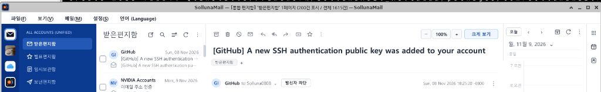
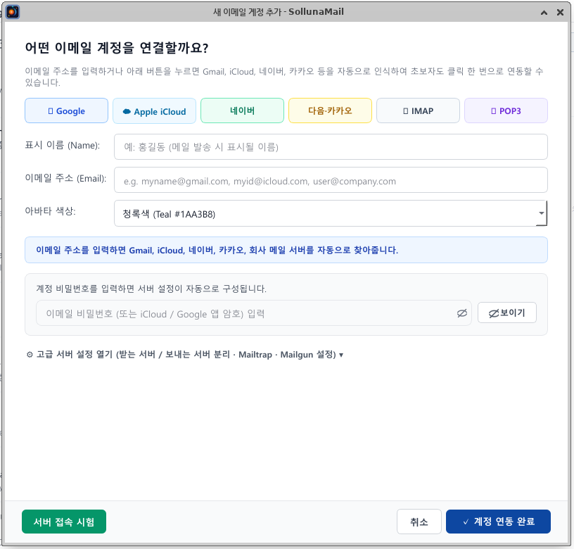
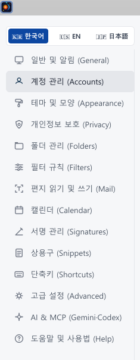
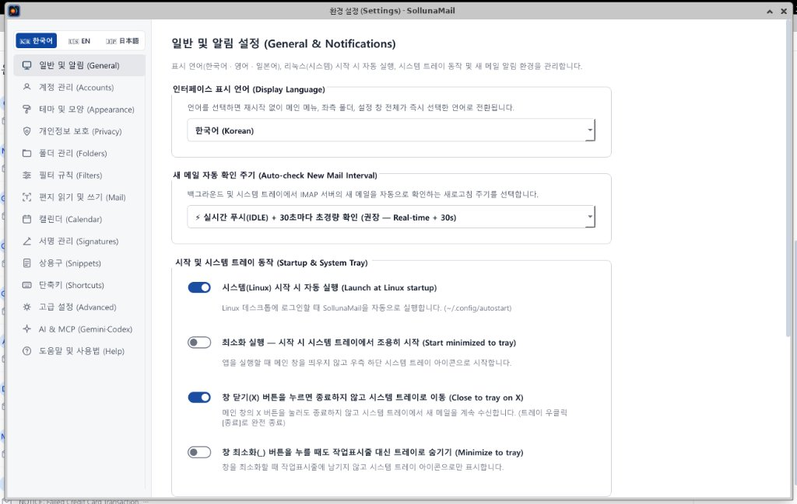
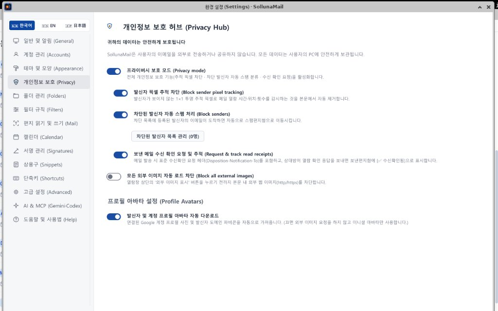
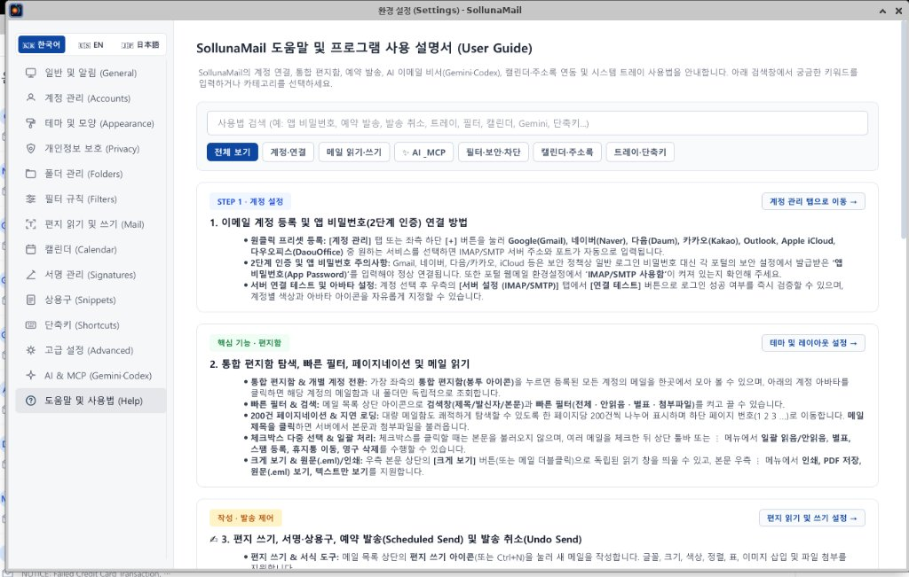

# SollunaMail

**SollunaMail**은 Qt 6 (C++17) 기반의 크로스플랫폼(Windows · Linux · macOS) 통합 이메일·캘린더·주소록 클라이언트입니다.

---

## 주요 기능 (Key Features)

- **멀티 계정 통합 메일함 (Unified Inbox):**
  - Google (Gmail OAuth 2.0 & 16자리 앱 비밀번호), Apple iCloud, 네이버(Naver), 다음·카카오(Daum/Kakao), Microsoft Outlook 및 일반 회사/도메인 IMAP·POP3·SMTP 계정 지원
  - 보내는 메일 서버(SMTP) 분리 설정 지원 (Mailtrap, Mailgun, SendGrid, Custom SMTP)
- **실시간 메일 수신 및 메일 관리:**
  - IMAP IDLE 실시간 푸시 및 백그라운드 주기 동기화
  - POP3 로컬 메일함 영구 보관(`pop3/`) 및 서버 복사본 유지 옵션
  - 예약 발송, 수신 확인(MDN), 추적 픽셀 차단(Privacy Hub), 발신자 차단 및 스팸 관리
- **캘린더 & 주소록 통합 연동:**
  - Google Calendar / Apple iCloud CalDAV 양방향 동기화 및 로컬 일정·공휴일 표시
  - Google Contacts / iCloud CardDAV 주소록 동기화 및 자동 완성
- **다국어 & 테마 지원:**
  - 한국어(🇰🇷) · 영어(🇺🇸) · 일본어(🇯🇵) 실시간 전환
  - 다크 모드 / 라이트 모드 및 다양한 강조 색상 테마 지원
- **AI & MCP (Model Context Protocol) 연동:**
  - Gemini, Claude, Codex(ChatGPT) 기반 이메일 요약·번역·답장 초안 작성 및 `--mcp-stdio` 서버 내장

---

## 주요 화면 (Screenshots)

### 1. 통합 편지함 · 메일 뷰어 · 우측 캘린더 사이드바


### 2. 원클릭 이메일 계정 연결 마법사 (Google · iCloud · 네이버 · 다음/카카오 · IMAP · POP3)


### 3. 실시간 다국어 전환(🇰🇷 · 🇺🇸 · 🇯🇵) 및 통합 환경 설정
| 환경 설정 메뉴 | 일반 및 알림 (실시간 IDLE 푸시 & 트레이) |
| :---: | :---: |
|  |  |

### 4. 개인정보 보호 허브(Privacy Hub) 및 내장 사용 설명서(User Guide)
| 개인정보 보호 허브 (추적 픽셀 차단 & 수신 확인) | 내장 도움말 및 프로그램 사용 설명서 |
| :---: | :---: |
|  |  |

---

## 디렉터리 구조

```text
SollunaMail/
├── SollunaMail/                  # Qt 6 C++ 애플리케이션 소스 코드 및 리소스
│   ├── CMakeLists.txt            # CMake 빌드 설정
│   ├── oauth_secrets_local.h.example # Google OAuth 2.0 클라이언트 키 설정 템플릿
│   ├── main.cpp
│   ├── mainwindow.h / .cpp / _part2.cpp / .ui
│   ├── googleprovider.h / .cpp
│   ├── settingsdialog.h / .cpp
│   ├── composedialog.h / .cpp
│   ├── customwidgets.h / .cpp
│   ├── mailmodels.h
│   └── mailtheme.h / .cpp
├── QtInstallerFramework/         # Windows 설치 프로그램(SollunaMail_Installer.exe) 구성 스크립트 (Qt IFW)
│   ├── how_to_make_install_file.txt
│   └── SollunaMail_MSVC2022/
│       ├── config/               # config.xml, controller.qs, 아이콘/로고
│       └── packages/com.sollunamail.app/meta/ # package.xml, installscripts.qs, UI
├── Mac_Install/                  # macOS 디스크 이미지(SollunaMail_1.0.0_macOS.dmg) 자동 빌드 도구
│   ├── build_dmg.sh              # macdeployqt + codesign + hdiutil 기반 .dmg 생성 스크립트
│   └── how_to_make_dmg.txt       # macOS 패키지 생성 및 설치 안내서
├── Linux_Install/                # Linux Debian (sollunamail_1.0.0_amd64.deb) 자립형 설치 패키지 생성 도구
│   ├── build_deb.sh              # Qt 6 런타임 포함 .deb 패키지 자동 빌드 스크립트
│   ├── how_to_make_deb.txt
│   └── README.md                 # 리눅스 패키지 생성 및 설치 안내서
├── screenshots/                  # README 문서용 애플리케이션 실행 스크린샷
└── LICENSE                       # MIT 오픈소스 라이선스
```

---

## 빌드 방법 (Build Instructions)

### 1. 필수 환경
- **Qt 6.5 이상** (`Core`, `Gui`, `Widgets`, `Network`, `LinguistTools`, 선택: `WebEngineWidgets`)
- **CMake 3.19 이상** 및 C++17 호환 컴파일러 (GCC / Clang / MSVC 2022)

### 2. Google OAuth 2.0 클라이언트 키 설정 (선택 사항)
보안을 위해 실제 Google OAuth 2.0 Client ID / Secret 헤더(`oauth_secrets_local.h`)는 저장소에 포함되지 않습니다.
내장 Google 브라우저 로그인을 사용하려면 템플릿 파일을 복사하여 키를 설정하세요:

```bash
cp SollunaMail/oauth_secrets_local.h.example SollunaMail/oauth_secrets_local.h
```
또는 실행 중 **[환경 설정 → 고급 설정]** 화면에서 사용자 지정 Google Client ID / Secret을 입력하거나 Google 16자리 앱 비밀번호로 연동할 수 있습니다.

### 3. CMake 빌드
```bash
cmake -S SollunaMail -B build -DCMAKE_BUILD_TYPE=Release
cmake --build build --parallel
```

---

## 운영체제별 설치 패키지 생성 (Installer Packaging)

### 1. Windows (`SollunaMail_Installer.exe` — Qt Installer Framework)
`windeployqt`로 배포 파일들을 `packages/com.sollunamail.app/data/`에 배치한 뒤 Qt IFW의 `binarycreator.exe`를 실행합니다. 자세한 절차는 [`QtInstallerFramework/how_to_make_install_file.txt`](QtInstallerFramework/how_to_make_install_file.txt)를 참고하세요.

### 2. macOS (`SollunaMail_1.0.0_macOS.dmg`)
macOS 환경에서 아래 스크립트를 실행하면 `macdeployqt`, 코드 서명(`codesign`), `hdiutil` 압축까지 자동으로 수행되어 자립형 `.dmg` 이미지가 생성됩니다:
```bash
cd Mac_Install
./build_dmg.sh
```
자세한 내용은 [`Mac_Install/how_to_make_dmg.txt`](Mac_Install/how_to_make_dmg.txt)를 참고하세요.

### 3. Linux Debian (`sollunamail_1.0.0_amd64.deb`)
Linux Release 빌드 완료 후 아래 스크립트를 실행하면 Qt 6 공유 라이브러리와 플러그인이 모두 번들링된 자립형 `.deb` 설치 파일이 생성됩니다:
```bash
cd Linux_Install
./build_deb.sh /path/to/Release/build/dir
```
자세한 내용은 [`Linux_Install/README.md`](Linux_Install/README.md)를 참고하세요.

---

## 라이선스 (License)

본 프로젝트(**SollunaMail**)는 **[MIT License](LICENSE)** 하에 배포됩니다.

- 누구나 본 소프트웨어를 자유롭게 사용, 복제, **수정**, 병합, 게시 및 재배포할 수 있습니다.
- 단, **소스코드를 수정하여 사용하거나 재배포할 경우 반드시 원저작자(`Copyright (c) 2026 Solluna0808`) 출처 표기와 [`LICENSE`](LICENSE) 전문을 포함**해야 합니다.
- 본 소프트웨어는 Qt 6 오픈소스 라이브러리(LGPL v3, 동적 링크)를 사용합니다.
